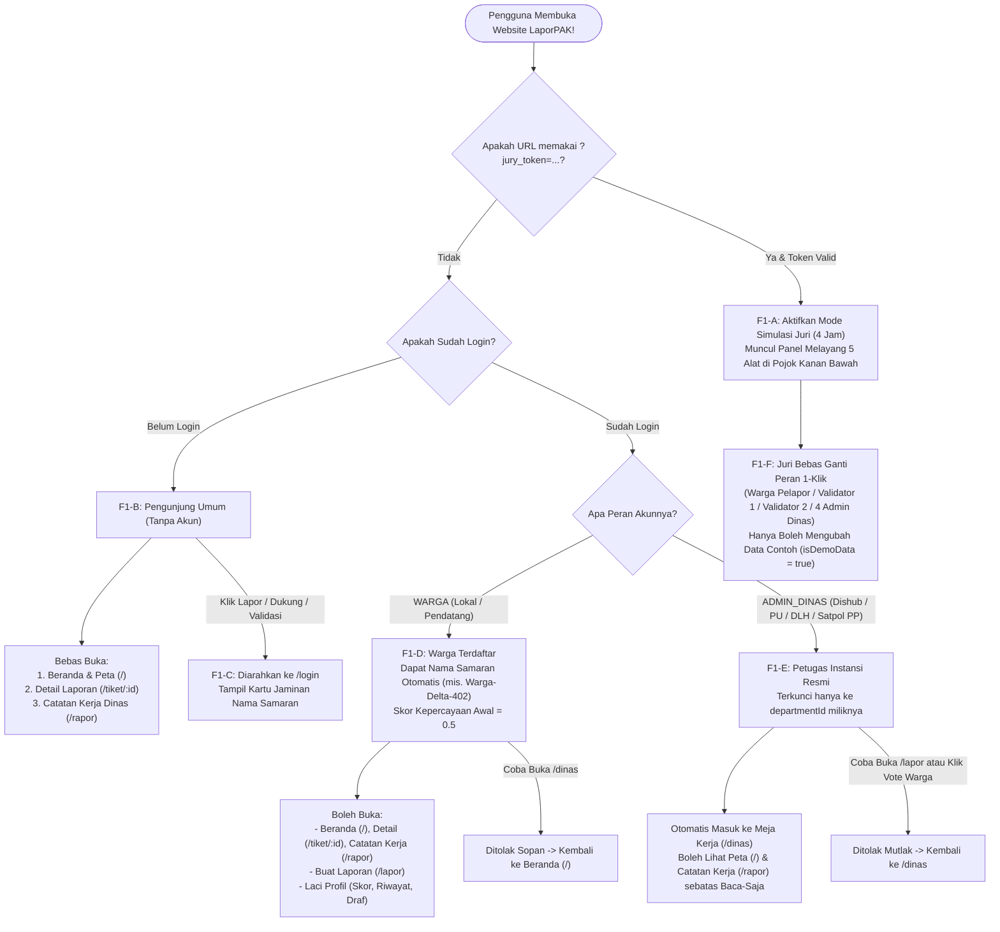
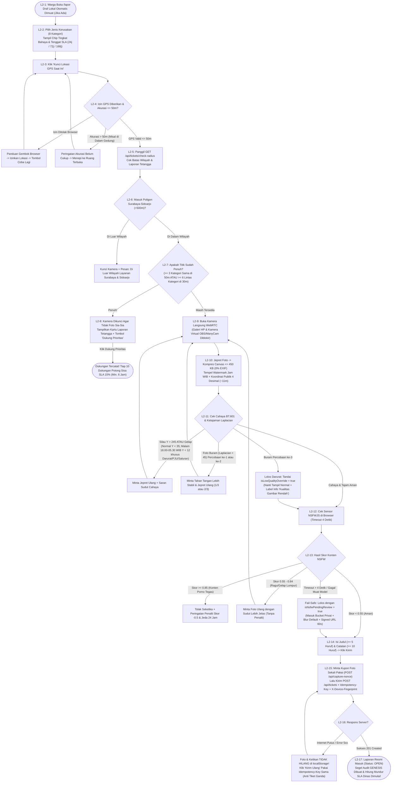
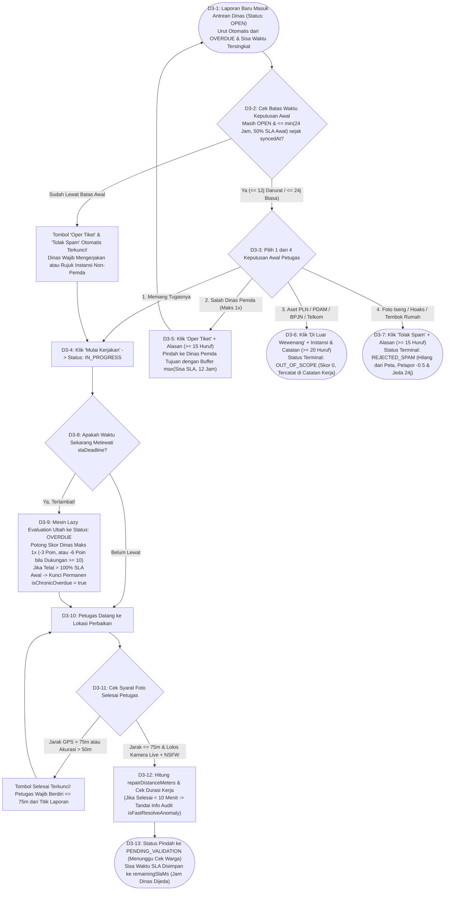
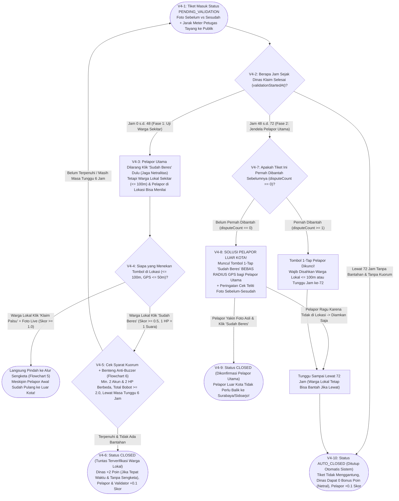
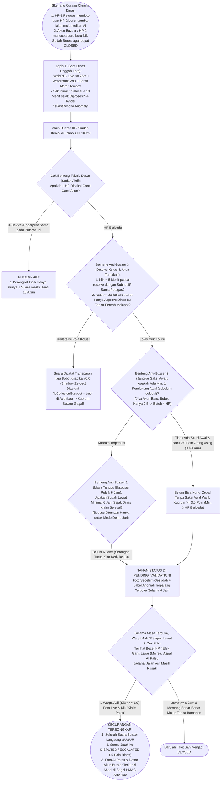
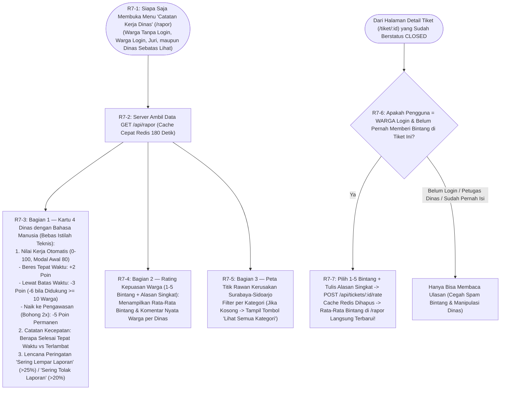
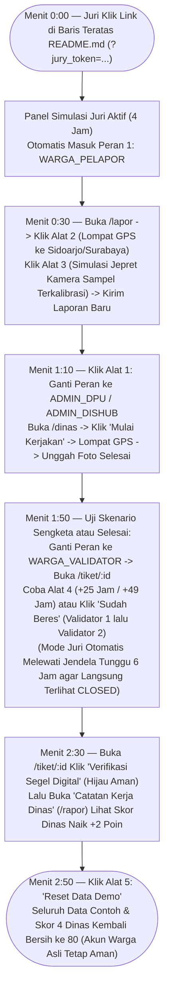

# LaporPAK! v3.5 — Panduan Alur Lengkap & Bedah Satu per Satu (*Master Flow Guide*)

> **Tujuan Dokumen Ini:** Dokumen ini memecah seluruh cara kerja **LaporPAK! v3.5** menjadi **8 Flowchart Terpisah yang Sangat Detail** (tidak digabung menumpuk dalam 1 gambar sempit). Setiap flowchart langsung diikuti **Penjelasan Urut Satu per Satu (Kotak demi Kotak)** dalam bahasa sehari-hari + aturan teknisnya agar **Arya**, **Fatih**, dan **Reza** punya pemahaman `100%` sama saat diskusi maupun coding.
>
> **Catatan Status Fitur v3.5:** Alur utama (`Flow 1`–`Flow 5` & `Flow 8`) sudah aktif di backend/kamera produksi saat ini (`main`), sedangkan penguatan **3 Benteng Anti-Buzzer (`Flow 6`)** dan **Rating Bintang di Catatan Kerja Dinas (`Flow 7`)** sudah dikunci di desain dokumen ini dan **menunggu aba-aba eksekusi kode** setelah 4 halaman UI utama selesai.

---

## Daftar Isi 8 Flowchart
1. **Flowchart 1:** Peta Gerbang Masuk & Hak Akses 5 Tipe Pengguna
2. **Flowchart 2:** Alur Lengkap Warga Membuat Laporan Baru (`/lapor`) — Dari Cek Titik Sampai Kirim Aman Sinyal Putus
3. **Flowchart 3:** Alur Lengkap Meja Kerja Pemerintah (`/dinas`) — Dari Laporan Masuk Sampai Unggah Foto Selesai
4. **Flowchart 4:** Alur Uji Publik (`PENDING_VALIDATION`) & Solusi Pelapor Luar Kota (Surabaya/Sidoarjo) yang Sudah Pulang
5. **Flowchart 5:** Alur Detail Perulangan Bantahan / Sengketa (`DISPUTED` Jalur A vs Jalur B & `ESCALATED` Berita Acara)
6. **Flowchart 6:** Alur Pertahanan Anti-Buzzer, Akun Ternakan (*Pre-Aged Sybil*), Tutup Kilat & Foto Layar HP AI (*Screen Spoofing*)
7. **Flowchart 7:** Alur Halaman **"Catatan Kerja Dinas"** (`/rapor`) — Nilai Kerja Otomatis + Rating Bintang Warga
8. **Flowchart 8:** Alur Simulasi Dewan Juri `< 3 Menit` (`/?jury_token=...`)

---

## 1. Flowchart 1: Peta Gerbang Masuk & Hak Akses 5 Tipe Pengguna

Diagram ini menjelaskan siapa saja yang membuka website **LaporPAK!** dan halaman mana yang boleh atau dilarang mereka masuki.

### Penjelasan Urut Satu per Satu (Kotak demi Kotak):
1. **`Pengguna Membuka Website` -> `Cek ?jury_token=`:** Begitu halaman dibuka, sistem memeriksa apakah link mengandung token khusus juri dari `README.md`.
2. **`F1-A (Mode Simulasi Juri)` & `F1-F`:** Jika token cocok, juri mendapat sesi khusus `4 jam`. Juri tidak perlu daftar akun manual dan bisa berpindah peran dalam `1` klik, namun sistem mengunci ketat agar juri hanya bisa mengutak-atik data contoh (`isDemoData: true`), bukan laporan warga sungguhan.
3. **`F1-B (Pengunjung Umum Belum Login)`:** Warga yang baru pertama kali masuk **tidak dihadang halaman login**. Mereka langsung bisa menggeser peta kerusakan Surabaya–Sidoarjo (`/`), melihat geseran foto Sebelum–Sesudah (`/tiket/:id`), dan membaca **Catatan Kerja Dinas** (`/rapor`).
4. **`F1-C (Halaman /login)`:** Login baru diminta ketika warga ingin melakukan aksi nyata (melapor, mendukung prioritas, atau memvalidasi). Tepat di bawah tombol *Masuk dengan Google* / *Email*, tertulis jaminan bahwa nama asli & email warga tidak pernah ditampilkan ke publik maupun dinas.
5. **`F1-D (Warga Terdaftar — Lokal maupun Luar Kota)`:** Saat warga pertama kali masuk, backend otomatis membuatkan nama samaran acak (`Warga-Delta-402`) dan modal skor kepercayaan `0.5`. Warga bebas melapor selama saat memotret kerusakan ia memang sedang berada secara fisik di wilayah Surabaya–Sidoarjo. Warga tidak bisa membuka `/dinas`.
6. **`F1-E (Petugas Instansi / ADMIN_DINAS)`:** Akun dinas (`dishub@laporpak.id`, `dpu@laporpak.id`, `dlh@laporpak.id`, `satpolpp@laporpak.id`) otomatis diarahkan ke dashboard `/dinas`. Petugas Dishub **mustahil** mengubah laporan milik Dinas PU, dilarang membuat laporan warga (`/lapor`), dilarang ikut voting warga, dan hanya bisa melihat halaman **Catatan Kerja Dinas** (`/rapor`) tanpa bisa mengedit nilainya.

---

## 2. Flowchart 2: Alur Lengkap Warga Membuat Laporan Baru (`/lapor`)

Diagram ini membedah urutan pelaporan dari pemilihan lokasi sampai pengiriman laporan agar warga tidak memotret sia-sia dan ketikannya tidak hilang saat sinyal jelek.

### Penjelasan Urut Satu per Satu (Kotak demi Kotak):
1. **`L2-1` s.d. `L2-3` (Draf Otomatis & Kategori):** Setiap ketikan dan foto sementara disimpan di `localStorage` perangkat warga. Begitu warga memilih kategori (misal *Jalan Ambles*), layar langsung memberi tahu bahwa laporan ini bertipe **DARURAT (batas waktu dinas 24 jam)**.
2. **`L2-4` (Penjaga GPS):** Jika izin lokasi tidak sengaja tertolak, muncul panduan bergambar teks (*klik ikon gembok -> Izinkan*). Jika warga di dalam ruangan sehingga GPS meleset `> 50 meter`, sistem meminta warga bergeser ke area terbuka dulu agar titik laporan tidak salah jalan.
3. **`L2-5` s.d. `L2-8` (Cek Wilayah & Anti-Duplikat Sebelum Kamera):** Sebelum warga repot memotret, server mengecek apakah posisi masuk Surabaya–Sidoarjo dan apakah di radius `50 meter` sudah ada `3` laporan serupa (atau `6` laporan apa pun di `30 meter`). Bila penuh, kamera dikunci dan warga langsung disajikan daftar laporan tetangga di dekatnya lengkap dengan tombol **Dukung Prioritas** (tiap kelipatan `10` dukungan memangkas sisa waktu dinas `15%`, minimal `6 jam`, dan menggandakan denda terlambat dinas menjadi `-6 poin`).
4. **`L2-9` & `L2-10` (Kamera WebRTC Murni & Privasi):** Tombol unggah file galeri ditiadakan total dan kamera virtual (`OBS`/`ManyCam`) ditolak. Hasil jepretan digambar ulang di Canvas (`<= 450 KB`) sehingga metadata EXIF HP hilang `100%`, lalu ditempel watermark waktu `WIB` dan koordinat yang sudah dibulatkan `4` desimal (`~11 meter` agar alamat persis rumah pelapor tetap aman).
5. **`L2-11` (Cek Cahaya Malam & Foto Buram):** Siang/normal wajib kecerahan `Y >= 35`. Khusus malam hari (`18.00–05.30 WIB`) untuk `5` kategori darurat/gelap (`JALAN_AMBLES`, `KABEL_MENJUNTAI`, `POHON_TUMBANG`, `PJU_MATI`, `SALURAN_TERSUMBAT`), batas diturunkan ke `Y >= 12` supaya warga tetap bisa melapor lampu jalan mati. Jika kamera HP warga murahan sehingga buram terus, percobaan ke-`3` tetap diizinkan lewat (`isLowQualityOverride = true`).
6. **`L2-12` & `L2-13` (Sensor NSFW 2-Zona + Fail-Safe):** Model `nsfwjs` baru diunduh saat memotret agar pembukaan web awal tetap cepat (`< 2 detik`). Skor `>= 0.85` diblokir tegas, skor `0.55–0.84` hanya diminta foto ulang tanpa hukuman, dan bila internet lambat (`> 4 detik`), foto tetap diterima masuk ruang penyimpanan privat (*blur* otomatis hingga diklik *Tampilkan Gambar*).
7. **`L2-14` s.d. `L2-17` (Kupon Foto & Anti-Dobel Kirim):** Sistem meminta kupon `captureNonce` sekali pakai yang terikat ke perangkat (`X-Device-Fingerprint`), lalu mengirim laporan memakai `Idempotency-Key`. Jika sinyal warga mati di tengah jalan lalu warga menekan *Kirim Ulang* berkali-kali, server mengenali `Idempotency-Key` yang sama sehingga tidak pernah tercipta laporan kembar.

---

## 3. Flowchart 3: Alur Lengkap Meja Kerja Pemerintah (`/dinas`)

Diagram ini menjelaskan apa yang terjadi sejak laporan warga mendarat di antrean salah satu dinas hingga petugas mengunggah foto bukti perbaikan.

### Penjelasan Urut Satu per Satu (Kotak demi Kotak):
1. **`D3-1` & `D3-2` (Aturan Anti-Cuci-Tangan Mepet Tenggat):** Begitu laporan masuk (`OPEN`), waktu dinas langsung berjalan. Dinas hanya diberi jendela separuh awal (`maksimal 12 jam` untuk kategori Darurat `24 jam`, atau `24 jam` untuk kategori `72/168 jam`) untuk mengoper laporan ke dinas lain atau menolak spam. Lewat dari itu, tombol *Oper* dan *Tolak Spam* mati otomatis agar oknum dinas tidak membuang laporan `5 menit` sebelum tenggat habis.
2. **`D3-5` (`Oper Tiket` Maks 1x):** Misalnya warga melapor *Kabel Bahaya* ke Dishub, padahal di lapangan butuh penanganan Dinas PU. Dishub boleh mengoper **maksimal 1 kali** (tidak boleh lempar-lemparan bolak-balik), dan dinas penerima dijamin mendapat waktu kerja minimal `12 jam`.
3. **`D3-6` & `D3-7` (`OUT_OF_SCOPE` & `REJECTED_SPAM` Diawasi Publik):** Kalau objeknya tiang listrik PLN/pipa PDAM, dinas memilih *Di Luar Wewenang* dengan catatan terbuka. Kalau fotonya iseng/palsu, dinas memilih *Tolak Spam* (pelapor dikurangi `-0.5` skor; khusus pelanggaran pertama akun baru berhenti di lantai `0.1` agar tidak langsung terblokir `7 hari`). Semua rasio pelemparan dan penolakan ini dihitung terbuka di halaman **Catatan Kerja Dinas** (`/rapor`) — jika `> 25%` atau `> 20%`, muncul tanda peringatan!
4. **`D3-8` & `D3-9` (Hukuman Otomatis Terlambat):** Tanpa perlu menunggu cron tengah malam, setiap kali halaman dibuka (*Lazy Evaluation*), sistem mengecek apakah tenggat `slaDeadline` sudah terlewat. Jika lewat, status langsung merah (`OVERDUE`) dan nilai dinas langsung dipotong `-3` (atau `-6` bila didukung `>= 10` warga) tepat **satu kali**.
5. **`D3-11` s.d. `D3-13` (Wajib Foto di Lokasi `<= 75m`):** Petugas yang mengklaim selesai wajib memotret langsung pada jarak `<= 75 meter` dari titik kerusakan asli. Sistem mencatat jarak meter petugas (`repairDistanceMeters`), menandai anomali bila dikerjakan kilat tidak wajar (`< 10 menit`), menjeda sisa waktu SLA di `remainingSlaMs`, lalu menyerahkan hasilnya ke warga sekitar (`PENDING_VALIDATION`).

---

## 4. Flowchart 4: Alur Uji Publik (`PENDING_VALIDATION`) & Solusi Pelapor Luar Kota yang Sudah Pulang

Diagram ini menjawab tuntas pertanyaan tim: **"Bagaimana kalau pelapornya orang luar Surabaya/Sidoarjo (misal pendatang/luar Jawa) yang waktu lapor ada di lokasi, tapi saat dinas selesai dia sudah pulang ke kotanya?"**

### Penjelasan Urut Satu per Satu (Kenapa Pelapor Luar Kota Aman `100%`):
1. **Saat Melapor Awal:** Pendatang dari luar Jawa/luar kota sedang berada di Surabaya/Sidoarjo, melihat jalan berlubang, lalu melapor di lokasi (`Flowchart 2`). Setelah itu ia pulang ke kota asalnya.
2. **`V4-3` & `V4-4` (Jam `0–48` — Diwakili Warga Lokal):** Begitu dinas selesai memperbaiki, sistem **tidak bergantung pada pelapor awal yang sudah pulang**. Dua warga lokal Surabaya/Sidoarjo yang lewat di radius `<= 100 meter` cukup menekan *Sudah Beres* -> laporan beres (`V4-6`), atau jika dinas berbohong, `1` warga lokal cukup memotret *Klaim Palsu* (`GoDispute`).
3. **`V4-8` & `V4-9` (Jam `48–72` — Hak Khusus Bebas GPS untuk Pelapor yang Sudah Pulang):** Bagaimana kalau jalan tersebut agak sepi sehingga sampai `2 hari` (`48 jam`) belum ada `2` warga lokal yang menekan tombol, dan belum ada sengketa (`disputeCount == 0`)? Pada jam ke-`48` s.d. `72`, sistem membuka **tombol konfirmasi 1-tap bebas syarat GPS khusus bagi Pelapor Utama**. Jadi pelapor yang sudah di luar pulau tetap bisa menutup laporannya setelah memeriksa foto *Before–After* dinas!
4. **`V4-10` (Lewat `72 Jam` — Jaring Pengaman Terakhir):** Kalau pelapor luar kota ragu menekan setuju karena tidak melihat aspalnya secara langsung (atau lupa membuka web), ia **tidak perlu memaksakan klik**. Begitu lewat `72 jam` tanpa bantahan, sistem otomatis menutup tiket ke `AUTO_CLOSED` agar antrean stabil, tetapi **dinas diberi bonus `0 poin`** supaya dinas tidak pernah diuntungkan oleh klaim diam-diam di lokasi sepi.

---

## 5. Flowchart 5: Alur Detail Perulangan Bantahan / Sengketa (`DISPUTED` & `ESCALATED`)

Diagram ini mengurai kebingungan soal **"bagaimana perulangan saat perbaikan dinas dibantah warga, kapan balik kerja ulang, kapan banding, dan kapan berhenti supaya tidak muter selamanya (anti-infinite-loop)"**.

```mermaid
flowchart TD
    S1(["S5-1: Tiket di PENDING_VALIDATION (Putaran ke-1)\nvalidationRound = 1, disputeCount = 0"]) --> S2["S5-2: Warga A (Skor >= 1.0, Jarak <= 100m)\nAmbil Foto Live Bukti Masih Rusak -> Klik 'Klaim Palsu'"]

    S2 --> S3["S5-3: Status Pindah ke DISPUTED (Dibantah Warga)\ndisputeCount naik jadi 1 | Waktu Bantah dicatat ke disputedAt\nDinas Diberi Batas Respons Maksimal 24 Jam!"]

    S3 --> S4{"S5-4: Apa Respons Dinas Dalam 24 Jam?"}

    S4 -->|"Jalur A: Dinas Mengakui Belum Rapi\nKlik 'Kerjakan Ulang' (reprocess-disputed)"| SA1["S5-5A: Status Kembali ke IN_PROGRESS\nisAppealRound = false\nBatas SLA Baru = Sisa SLA Lama + Tambahan 24 Jam"]
    S4 -->|"Dinas Diam > 24 Jam (Anti-Deadlock)"| SA2["S5-5B: Mesin Lazy Evaluation Paksa Masuk Jalur A Otomatis!\nStatus Jadi IN_PROGRESS (isAppealRound = false)"]
    SA1 --> SA3["S5-6A: Petugas Perbaiki Fisik di Lapangan & Unggah Foto Selesai Baru (<= 75m)"]
    SA2 --> SA3
    SA3 --> Round2A["S5-7A: Masuk PENDING_VALIDATION Putaran ke-2\nvalidationRound = 2, disputeCount tetap 1, isAppealRound = false\nSuara Putaran 1 Direset ke 0 (Warga Boleh Menilai Hasil Baru)"]

    S4 -->|"Jalur B (Maksimal 1x Seumur Tiket!):\nDinas Yakin Sudah Benar & Warga A Bohong\nUnggah Foto Sudut Baru <= 75m + Klik 'Ajukan Banding'"| SB1["S5-5C: Masuk PENDING_VALIDATION Putaran Banding\nvalidationRound = 2, disputeCount tetap 1, isAppealRound = true\nTombol Banding Dinas Dikunci Permanen (Tidak Bisa Dipakai Lagi)"]

    SB1 --> SB2["S5-6B: ATURAN NETRALITAS BANDING:\nWarga A (Pembantah Putaran 1) DILARANG Ikut Vote / Bantah Lagi!\nHarus Diuji oleh Warga Lain di Sekitar Lokasi (<= 100m)"]

    Round2A --> CheckR2{"S5-8: Apa Hasil Uji Publik Putaran ke-2?"}
    SB2 --> CheckR2

    CheckR2 -->|"Disetujui Kuorum >= 2 Warga Lain (Skor >= 2.0)"| R2Closed{"S5-9: Apakah Ini Tadi Jalur Banding (isAppealRound == true)?"}
    R2Closed -->|"Tidak (Jalur A Kerja Ulang)"| WinA(["S5-10A: Status CLOSED (Tuntas Pasca-Perbaikan Ulang)\nDinas Dapat 0 Bonus (Karena Pernah Dibantah), Warga A TIDAK Dihukum"])
    R2Closed -->|"Ya (Jalur B Banding Dinas Terbukti Benar!)"| WinB(["S5-10B: Status CLOSED\nWarga A Terbukti Membantah Palsu -> Kena Penalti Skor -0.5 + Jeda 24 Jam!"])

    CheckR2 -->|"Dibantah Lagi oleh Warga B (Skor >= 1.0, Foto Live <= 100m)"| Esc1["S5-11: Bantahan ke-2! Status Langsung NAIK KE ESCALATED\ndisputeCount = 2 | Skor Dinas Langsung Dipotong -5 Poin PERMANEN!"]

    Esc1 --> Esc2["S5-12: TIDAK ADA LAGI BANDING ATAU LOOP KE-3!\nDinas Wajib Unggah 2 Bukti Sekaligus di /dinas:\n1. Dokumen Berita Acara Resmi Berjenjang (PDF/JPG/PNG <= 5 MB)\n2. Foto Lapangan Live Terbaru (<= 75m)"]
    Esc2 --> EscClosed(["S5-13: Status CLOSED ('Diselesaikan via Berita Acara Eskalasi')\nPotongan -5 Poin Dinas Tetap Permanen, Pelapor + Warga A + Warga B Dapat +0.1 Skor"])
```

### Penjelasan Urut Satu per Satu (Kenapa Tidak Mungkin Berputar Tanpa Akhir):
1. **Maksimal Hanya Ada `2` Kali Bantahan (`disputeCount` `1` lalu `2`):** Tidak ada bantahan ke-`3`, ke-`4`, dst.
2. **Bantahan Pertama (`S5-2` -> `S5-3`):** Mengubah status ke `DISPUTED`. Jika dinas mendiamkan sengketa lebih dari `24 jam` (`S5-5B`), sistem otomatis memaksa dinas masuk status kerja ulang (`IN_PROGRESS`) supaya laporan tidak pernah menggantung.
3. **Bedanya Jalur A vs Jalur B (`S5-5A` vs `S5-5C`):**
   - **Jalur A (Kerja Ulang):** Dinas memperbaiki ulang di lokasi. Kalau setelah diperbaiki ulang warga setuju beres (`S5-10A`), pembantah pertama **tidak dihukum** karena bantahannya memang membuat jalan diperbaiki ulang!
   - **Jalur B (Banding Dinas — Maks `1x`):** Dinas merasa pekerjaannya sudah benar sejak awal dan warga pertama hanya usil. Di putaran banding ini (`isAppealRound = true`), **pembantah pertama dikunci tidak boleh ikut memencet tombol** (`S5-6B`). Bila minimal `2` warga lain menyatakan pekerjaan dinas memang sudah beres (`S5-10B`), barulah pembantah pertama yang usil tadi terkena hukuman `-0.5` skor + jeda `24 jam`.
4. **Bantahan Kedua = Palu Terakhir `ESCALATED` (`S5-11` s.d. `S5-13`):** Begitu ada warga kedua yang membuktikan lewat foto *live* bahwa jalan masih rusak, dinas langsung kehilangan **`-5 poin`** secara permanen dan wajib melampirkan dokumen resmi **Berita Acara PDF** yang ditandatangani pejabat + foto lapangan untuk menutup tiket. Siklus selesai tuntas tanpa putaran ke-`3`.

---

## 6. Flowchart 6: Alur Pertahanan Anti-Buzzer, Akun Ternakan & Anti-*Screen Spoofing* *(Penguatan v3.5)*

Diagram ini membedah skenario kecurangan ekstrem yang ditanyakan tim: **"Bagaimana jika oknum dinas membawa 2 HP (HP ke-2 menampilkan foto jalan mulus hasil AI lalu difoto oleh HP ke-1 petugas), lalu memakai akun ternakan lama / buzzer bayaran untuk buru-buru menekan Approve?"**

### Penjelasan Urut Satu per Satu (Cara Kerja 6 Lapis Pertahanan):
1. **`Lapis 1` (Menangkal Foto Layar HP + AI / *Screen Spoofing*):** Memotret layar HP kedua dari dekat selalu menyisakan cacat visual dibanding foto jalan asli (pantulan kaca, pola garis piksel *moiré*, warna aspal tidak menyatu dengan trotoar foto *Before*, atau diselesaikan hanya `3 menit` setelah tiket diambil sehingga otomatis diberi label peringatan **`Selesai Sangat Cepat — Perlu Cek Teliti`**). Karena foto *Before–After* dipajang berdampingan ke publik, kebohongan ini mudah terlihat oleh warga sekitar.
2. **`Guard 1` (Anti-Kloning `1` HP Banyak Akun — Sudah Aktif):** Kode `X-Device-Fingerprint` (`SHA-256` perangkat) mengunci `1` HP = `1` suara per putaran. Petugas membawa `1` HP cadangan lalu login-logout `4` akun tetap gagal di suara ke-`2`.
3. **`Guard 2` (Solusi Anti-Buzzer 3 — Mematikan Akun Ternakan Lama / *Pre-Aged Sybil*):** Sekalipun akun palsu sudah disiapkan berbulan-bulan sebelumnya, perilaku akun ternakan selalu mencolok: selalu muncul `< 5 menit` setelah petugas yang sama menekan *Selesai* di jaringan/hotspot yang sama, atau tidak pernah melapor kerusakan tapi kerjanya hanya menyetujui satu dinas tertentu (`>= 3x`). Sistem otomatis mengenolkan bobot suaranya (`effectiveWeight = 0.0`).
4. **`Guard 3` (Solusi Anti-Buzzer 2 — Jangkar Saksi Awal):** Dua akun asing yang baru muncul setelah dinas selesai tidak cukup untuk menutup tiket cepat apabila tidak ada satu pun warga pendukung awal laporan tersebut — sistem menuntut minimal `1` pendukung awal atau menaikkan syarat menjadi `>= 3.0 poin` (`>= 3` perangkat berbeda).
5. **`Guard 4` (Solusi Anti-Buzzer 1 — Mematikan Serangan "Tutup Kilat" dengan Masa Tunggu `6 Jam`):** Inilah kunci utamanya. Walaupun buzzer langsung menekan *Sudah Beres* pada detik ke-`10` setelah petugas selesai, sistem **menolak mengunci tiket ke `CLOSED` sebelum minimal `6 jam` berlalu**. Tiket tetap terbuka di peta sebagai *Menunggu Cek Warga*.
6. **`Bust` (`1` Bantahan Warga Asli Mengalahkan Keroyokan Buzzer):** Selama jendela terbuka tersebut, cukup **`1` orang warga jujur** (`skor >= 1.0`) yang lewat di jalan itu dan memotret kondisi asli yang masih berlubang (*Klaim Palsu*), seluruh suara buzzer langsung gugur, tiket masuk sengketa/eskalasi (`-5 poin` dinas), dan bukti foto AI palsu beserta nama samaran penyetujunya tersegel permanen di `AuditLog` `HMAC-SHA256` (tidak bisa dihapus dinas).

---

## 7. Flowchart 7: Alur Halaman "Catatan Kerja Dinas" (`/rapor`) — Nilai Otomatis + Rating Bintang Warga

Diagram ini menjelaskan hasil kesepakatan tim untuk mengganti istilah kaku *"Rapor Integritas"* menjadi **"Catatan Kerja Dinas"** yang mudah dimengerti warga awam sekaligus menggabungkan nilai otomatis dengan ulasan bintang warga.

### Penjelasan Urut Satu per Satu:
1. **Kenapa Dua Indikator Digabung (`R7-3` + `R7-4`):**
   - **Nilai Kerja Otomatis (`0–100`)** menjaga keadilan objektif untuk lomba (tidak bisa diserbu spam bintang palsu karena dihitung murni dari ketepatan waktu dan bukti fisik lapangan), namun kata-katanya diterjemahkan total ke bahasa sehari-hari warga.
   - **Rating Bintang Warga (`1–5 Bintang` + alasan)** memenuhi kebutuhan pengguna awam yang terbiasa membaca ulasan bintang seperti layanan publik/sekolah.
2. **Anti-Spam Ulasan (`R7-6` & `R7-7`):** Ulasan bintang tidak dibuka bebas sebagai form kosong tanpa dasar, melainkan muncul pada laporan yang memang sudah **Selesai (`CLOSED`)** dengan batas `1` akun `1` ulasan per tiket, dan akun `ADMIN_DINAS` dilarang memberi bintang untuk dinasnya sendiri.

---

## 8. Flowchart 8: Alur Simulasi Dewan Juri `< 3 Menit` (`/?jury_token=...`)

Diagram ini adalah urutan baku saat presentasi/video demo maupun saat juri mencoba langsung dari laptop penjurian tanpa harus pergi ke jalanan Surabaya–Sidoarjo.

### Penjelasan Urut Satu per Satu:
1. **`J1`–`J3`:** Juri yang memakai PC tanpa kamera belakang atau berada di kota lain (misal Semarang/Jakarta) tetap bisa menguji pembuatan laporan lengkap beserta kupon `captureNonce` sah menggunakan Alat 2 (*GPS Simulator*) dan Alat 3 (*Simulasi Jepret Kamera*).
2. **`J4`–`J5`:** Dengan `1` klik pindah peran (`WARGA_PELAPOR` -> `ADMIN_DPU` -> `WARGA_VALIDATOR` -> `WARGA_VALIDATOR_2`), setiap peran simulasi diberi sidik perangkat simulasi terpisah sehingga juri bisa menuntaskan kuorum `2` warga di `1` laptop tanpa terhalang masa tunggu `6 jam`.
3. **`J6`–`J7`:** Setelah melihat segel `HMAC-SHA256` dan kenaikan nilai di **Catatan Kerja Dinas**, tombol **Reset Data Demo** membersihkan kembali semua percobaan juri ke kondisi awal (`skor 80`) dan menghapus cache Redis dalam hitungan detik.
