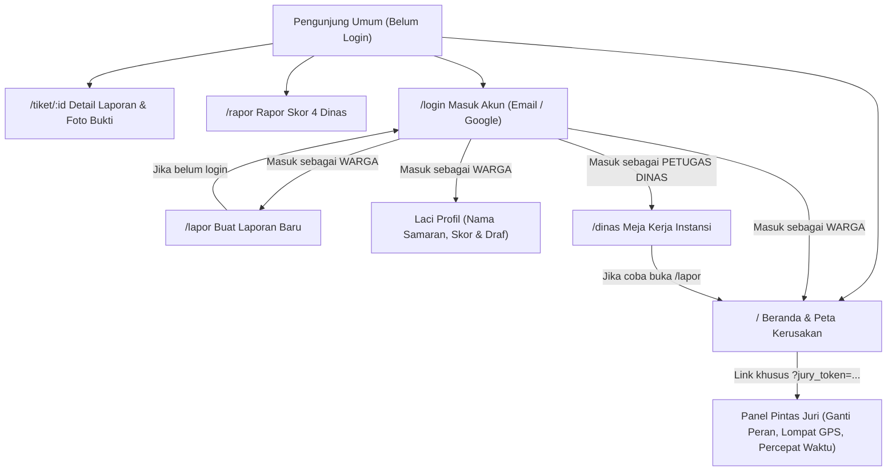
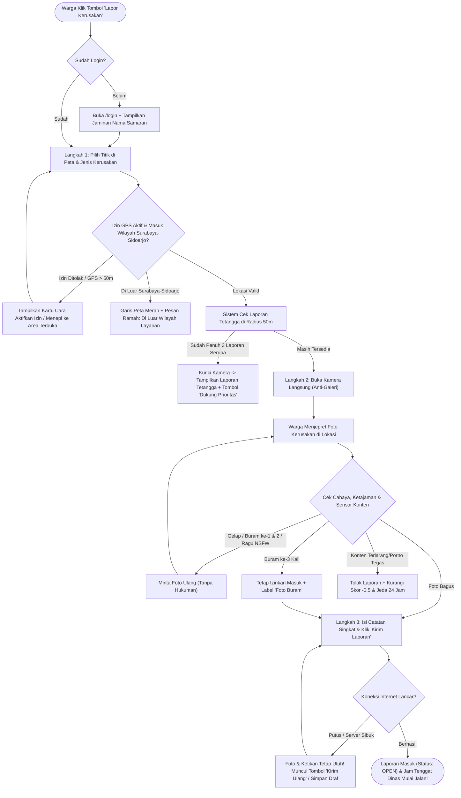
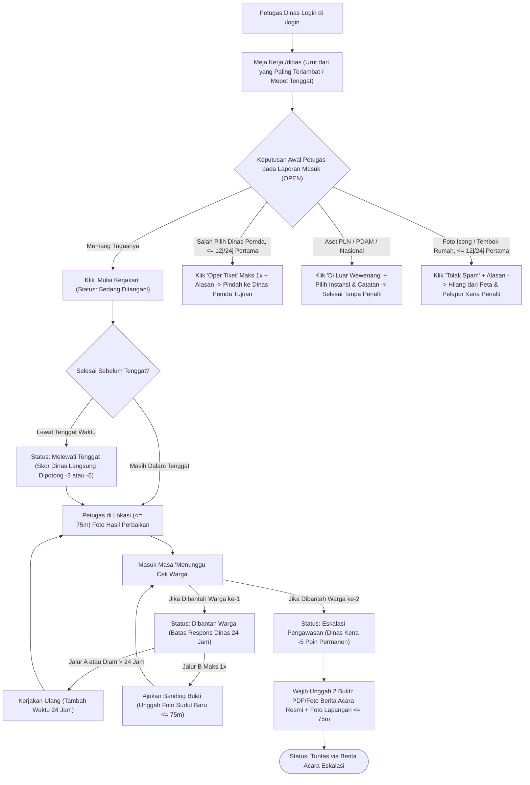

# LaporPAK! — Panduan Alur Pengguna & Sistem (*User & System Flow* Bahasa Awam)

> **Acuan Tunggal:** Dokumen ini menjelaskan alur [PRD v3.4](./PRD.md) dan [Design System](./design.md) dengan **bahasa sehari-hari yang mudah dipahami** (lengkap dengan diagram Mermaid) agar Arya, Fatih, dan Reza punya bayangan yang sama persis sebelum menyusun kode. Pembagian tugas detail ada di [docs/tasks.md](./tasks.md).

---

## 1. Peta Halaman Web: Siapa Boleh Masuk ke Mana?

Secara sederhana, web **LaporPAK!** hanya punya **5 halaman utama + 1 halaman login + 1 laci profil**. Setiap orang yang datang diarahkan sesuai perannya:



| Halaman | Pengunjung Umum | Warga (`WARGA`) | Petugas (`ADMIN_DINAS`) | Mode Juri (`?jury_token=`) | Penjelasan Sederhana |
| :--- | :---: | :---: | :---: | :---: | :--- |
| **`/`**, **`/tiket/:id`**, **`/rapor`** | Bebas Buka | Bebas Buka | Bebas Buka *(tanpa tombol Lapor/Vote)* | Bebas Buka | Warga bisa melihat peta, hitung mundur waktu dinas, foto Sebelum–Sesudah, dan rapor skor dinas **tanpa dipaksa login dulu**. |
| **`/login`** | Buka | Otomatis ke `/` | Otomatis ke `/dinas` | Bisa Ganti Peran 1-Klik | Satu pintu masuk. Warga bisa login cepat pakai Google dan langsung diberi **nama samaran acak** (contoh: `Warga-Delta-402`). |
| **`/lapor`** | Arahkan ke `/login` | Buka | Ditolak (kembali ke `/`) | Buka | Tempat warga memotret kerusakan jalan/lampu/sampah secara langsung. Petugas dinas tidak boleh membuat laporan warga. |
| **`/dinas`** | Arahkan ke `/login` | Ditolak (kembali ke `/`) | Buka *(khusus dinasnya)* | Buka *(saat pilih peran Dinas)* | Meja kerja pemerintah. Petugas Dishub hanya bisa melihat & mengerjakan laporan Dishub (tidak bisa menyentuh laporan Dinas PU). |

---

## 2. Alur 1: Perjalanan Warga Melaporkan Kerusakan (`/lapor`)

Alur ini dirancang supaya **pengguna pertama kali (*user awam*) tidak bingung**, tidak takut identitasnya bocor, dan tidak capek memotret kalau ternyata titik tersebut sudah dilaporkan orang lain:



### Penjelasan Bahasa Awam (Kenapa Urutannya Seperti Ini?):
1. **Jaminan Aman Sebelum Diminta Izin:** Warga sering takut kalau melapor bangunan/reklame liar nanti namanya dicari oknum. Karena itu, di halaman `/login` dan sebelum kamera terbuka, kita tampilkan pesan jelas: *"Tenang, nama asli & emailmu dirahasiakan. Di peta hanya muncul nama samaran dan titik lokasi disamarkan ±11 meter."*
2. **Cek Titik Penuh *Sebelum* Buka Kamera:** Jangan biarkan warga sudah panas-panas memotret di pinggir jalan, eh waktu klik kirim malah ditolak karena kuota titik penuh. Begitu warga memilih titik di peta, sistem langsung mengecek apakah sudah ada laporan tetangga di radius `50 meter`. Kalau sudah ada `3` laporan serupa, kamera dikunci dan warga langsung ditawari tombol **Dukung Prioritas** pada laporan tetangga tersebut.
3. **Kenapa Tidak Bisa Ambil Foto dari Galeri HP?** Di atas tombol kamera ada penjelasan singkat: *"Wajib foto langsung di lokasi supaya terbukti kejadian nyata hari ini (bukan foto lama atau comotan internet)."*
4. **Kalau Salah Pencet "Tolak Izin Kamera/GPS":** Layar tidak boleh kosong/gelap. Muncul kartu panduan sederhana: *"Ketuk ikon gembok di bagian atas browser → pilih Izinkan → tekan tombol Muat Ulang."*
5. **Ketikan & Foto Pantang Hilang Saat Sinyal Jelek:** Kalau internet warga putus tepat saat menekan *Kirim*, foto dan catatan yang sudah diketik tidak boleh terhapus. Warga cukup menekan **Kirim Ulang** (sistem memastikan laporan tidak akan tercatat dua kali).

---

## 3. Alur 2: Warga Mendukung Prioritas & Mengawal Klaim Selesai (`/tiket/:id`)

Setelah laporan masuk, warga sekitar tidak hanya menonton, tapi ikut **mempercepat tenggat dinas** dan **menjadi juri apakah perbaikan dinas benar-benar beres atau bohong**:

```mermaid
flowchart TD
    OpenTicket["Laporan Aktif (Laporan Masuk / Sedang Ditangani)"] --> Support["Warga Lain Klik 'Dukung Prioritas'"]
    Support --> CutSLA["Tiap 10 Dukungan: Sisa Waktu Dinas Dipotong 15% Lebih Cepat & Hukuman Telat Jadi -6 Poin"]

    OpenTicket --> DinasDone["Petugas Dinas Unggah Foto Bukti Selesai (Jarak <= 75m)"]
    DinasDone --> Pending["Status: Menunggu Cek Warga (Jam Dinas Berhenti Sementara)"]

    Pending --> Slider["Warga Melihat Geseran Foto Sebelum vs Sesudah + Bukti Jarak Meter Petugas"]
    Slider --> Choice{"Apa Penilaian Warga di Lokasi (<= 100m)?"}

    Choice -->|Sudah Bagus: Klik 'Sudah Beres'| Quorum{"Sudah Disetujui Min. 2 Warga (Skor >= 2.0) atau Pelapor di Hari ke-3?"}
    Quorum -->|Belum Cukup| Pending
    Quorum -->|Sudah Cukup| Closed(["Status: Tuntas Terverifikasi (Dinas +2 Poin, Warga +0.1 Skor)"])

    Choice -->|Masih Rusak / Bohong: Klik 'Klaim Palsu' + Foto Bukti| DisputeCount{"Bantahan ke Berapa?"}
    DisputeCount -->|Bantahan Pertama| Disputed["Status: Dibantah Warga (Kembali ke Meja Dinas, Wajib Respons <= 24 Jam)"]
    DisputeCount -->|Bantahan Kedua| Escalated["Status: Eskalasi Pengawasan (Dinas Kena -5 Poin Permanen & Wajib Berita Acara)"]

    Choice -->|Jalan Sepi: 3 Hari (72 Jam) Tidak Ada Respons| AutoClose(["Status: Ditutup Otomatis (Dinas Dapat 0 Poin Tambahan)"])
```

### Penjelasan Bahasa Awam:
- **Bukti Nyata di Bawah Foto Dinas:** Supaya warga percaya bahwa foto "Sesudah" bukan foto jalan lain, tepat di bawah foto tertulis: **`Diambil petugas 18 m dari titik laporan · 20 Nov 2026, 14:22 WIB`**.
- **Aturan Adil 2 Hari Pertama (`0–48 Jam`) vs Hari Ketiga (`48–72 Jam`):**
  - Selama **2 hari pertama** sejak dinas klaim selesai, pembuat laporan asli belum boleh menekan tombol *Sudah Beres* (biar tetangga sekitar radius `<= 100 m` yang menilai secara netral), tetapi pembuat laporan **boleh langsung menekan *Klaim Palsu*** kalau ternyata perbaikannya bohong.
  - Kalau sampai **hari ke-3 (`48–72 jam`)** belum cukup tetangga yang memvalidasi dan belum ada sengketa, pembuat laporan asli bisa langsung menekan **Sudah Beres** dari mana saja (bebas jarak).
  - Kalau sampai lewat **72 jam** tidak ada respons sama sekali, laporan ditutup otomatis (`Ditutup Otomatis / AUTO_CLOSED`), tetapi **dinas tidak mendapat bonus poin (`0` poin)** supaya klaim palsu di jalan sepi tidak pernah menguntungkan dinas.
- **Penjelasan Tombol Terkunci di Layar HP:** Kalau tombol *Sudah Beres* atau *Klaim Palsu* tidak bisa diklik (misalnya warga berada `240 meter` dari lokasi, atau warga baru punya skor kepercayaan `0.5` padahal *Klaim Palsu* butuh skor `1.0`), alasannya **ditulis langsung di bawah tombol** (karena di layar sentuh HP tidak ada kursor mouse untuk melihat *tooltip*).
- **Segel Anti-Rekayasa (Bahasa Sederhana):** Di bagian bawah halaman terdapat kotak *Segel Anti-Rekayasa*. Saat diklik **Verifikasi Rantai**, sistem mengecek apakah ada oknum yang pernah mengubah jam atau status laporan diam-diam di database, lalu menampilkan kalimat kesimpulan yang mudah dimengerti warga.

---

## 4. Alur 3: Meja Kerja Pemerintah (`/dinas`)

Saat petugas salah satu dari 4 instansi (**Dishub**, **Dinas PU Bina Marga**, **DLH**, atau **Satpol PP**) masuk lewat `/login`, mereka langsung diarahkan ke meja kerja `/dinas`:



### Aturan Penting agar Dinas Tidak Bisa Curang:
1. **Tidak Bisa Lempar Tanggung Jawab Saat Sudah Mepet Tenggat:** Tombol *Oper Tiket* dan *Tolak Spam* otomatis terkunci jika laporan sudah berstatus *Sedang Ditangani* atau sudah lewat separuh waktu awal (`12 jam` untuk laporan Darurat, `24 jam` untuk laporan biasa).
2. **Dilarang Menurunkan Tingkat Bahaya Laporan:** Dinas tidak punya tombol untuk mengubah laporan *Jalan Ambles (Darurat 24 jam)* menjadi *Jalan Berlubang Biasa (7 hari)*. Kalau warga berbohong soal darurat, dinas menolaknya lewat *Tolak Spam* di 12 jam pertama dengan alasan terbuka.
3. **Semua Penolakan & Pelemparan Dihitung di `/rapor`:** Kalau sebuah dinas terlalu sering melempar laporan sebagai *Di Luar Wewenang* (`> 25%`) atau terlalu sering menolak laporan warga sebagai *Spam* (`> 20%`), halaman `/rapor` otomatis memunculkan **lencana peringatan kuning** di samping nama dinas tersebut.

---

## 5. Alur 4: Mode Simulasi Dewan Juri (`/?jury_token=...`)

Karena dewan juri Techcomfest menguji web dari komputer/laptop di tempat penjurian (bukan di jalan raya Surabaya–Sidoarjo), link khusus yang dicantumkan di `README.md` menyalakan **Panel Simulasi Juri** dengan 5 tombol pintas:

1. **Ganti Peran 1-Klik (*Role Switcher*):** Berpindah instan antara *Warga Pelapor*, *Warga Sekitar (Validator)*, dan *4 Admin Dinas* tanpa perlu bolak-balik ketik email/password.
2. **Lompat Lokasi (*GPS Simulator*):** Memindahkan posisi GPS juri langsung ke titik laporan mana pun di Surabaya/Sidoarjo agar bisa menekan tombol yang mensyaratkan jarak `<= 75 m` atau `<= 100 m`.
3. **Simulasi Jepret Kamera Lapangan:** Bagi komputer juri yang tidak punya kamera belakang, tombol ini otomatis memasukkan foto sampel kerusakan/perbaikan jalan yang sudah disiapkan ke dalam mesin pemeriksa foto.
4. **Percepat Waktu (`+25 Jam` / `+49 Jam`):** Memajukan jam laporan secara instan supaya juri bisa langsung melihat perubahan status menjadi *Melewati Tenggat (`OVERDUE`)*, *Klaim Selesai Otomatis*, atau *Batas Respons Sengketa* dalam hitungan detik.
5. **Reset Demo:** Mengembalikan seluruh data contoh dan skor 4 dinas kembali bersih (`skor 80`) seperti semula, tanpa menghapus akun warga asli yang baru mendaftar.
